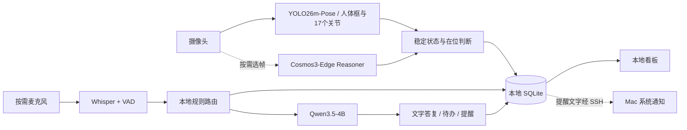

# Deskside Orin · 桌间

运行在 NVIDIA Jetson AGX Orin 上的本地工位助手。摄像头感知、模型推理和活动数据存储均在 Orin，通过中文看板查看坐站记录，使用语音或文字查询记录、添加待办与提醒。Mac 可通过 SSH/Tailscale 查看界面并接收无声系统通知。

**当前可运行，真实场景准确率仍待验收。** 椅背遮挡会影响坐站与在位识别，不能将模型统计视为人工验证的准确记录。

## 功能

- 坐姿、站姿、在位、离开、未知与隐私时段记录；人工标注另存，保留原始模型标签。
- 历史日期、全天时间轴、完整小时活动构成、重复摘要合并、站立目标。
- 展开「按时段查询」，输入北京时间的起止日期和钟点，可核对最长 24 小时内的坐站、推算、隐私和未采集时间。也可以问「昨天 9 点到 11 点我坐了多久」或「前天 22 点到昨天凌晨 2 点坐站各多久」。
- 展开「七日活动回顾」查看所选日及前六天的坐站、在位、推算和采集空档，点日期可核对当天。「下载 Markdown 周记」可将七天明细与合计保存到 Obsidian，导出内容只含统计。问「最近七天坐站各多久」或「给我看近7天工位回顾」会按截至今天的同一份本地统计回答。
- 在「活动时间段」点某一段的「依据 / 校正」，可把选中的个人坐站或离开记录改为本人确认的状态。当日分段校正支持撤销，原始区间和隐私记录保留。
- 时段里的「判断依据」分别列出原始识别、校正后的统计以及各自的时长。升级后开始随原有采样记录关节、动作和 Cosmos 等判断方法。早期时段会显示「细分来源未记录」，隐私时段隐藏判断细节。
- 回看历史时，在「一天的活动轨迹」点「确认本人离开」，可一次校正连续 1–31 个已结束的北京时间自然日。隐私和未采集时段保留。打开范围内任一天可整批撤销，已有人工坐站标注冲突时会提示具体日期。
- GPU/CPU、内存、Swap、温度、功耗、风扇、磁盘饼图与服务状态，每 15 秒更新。
- 按需实时画面，每秒 1 帧，叠加同一帧的状态、检测框和真实 YOLO26m-Pose 关键点，不补画缺失关节。
- 在「实时画面与姿态估计」打开「现场核验坐站识别」。到位时点坐、站或离开，暂离核验时可暂停。结束后可按自己标记的姿态核对误判、推测、未采集时长和切换延迟。时间取自 Orin，核验最长两小时，标记独立于活动记录。
- 可点击模型工作流；Whisper small/base/Turbo 本地切换，显示实际权重大小与明确标注的内存估算。
- 中文语音输入、文字答复、待办、久坐和定时提醒；Mac 无声系统通知独立于网页工作。勾选「校对后发送」可先编辑 Orin 的转写结果，点击发送才执行。
- 写作时可以说「记个灵感，文章从一把空椅子写起」，也可用「记灵感」输入多行。看板的「灵感」页签按日期保留原文，当天的灵感可下载为 Markdown，直接放进 Obsidian。
- 在「待办与提醒」勾选已办事项，误勾后可从「已完成」恢复。两份待办列表都能翻页找回较早的条目。
- 「提醒」按到期时间列出待发事项。通知发出前，可把一条提醒从原时间延后 10 分钟，或确认取消。时间按北京时间显示。
- 专注计时可从待办旁的计时按钮或自定主题启动，支持 1–180 分钟。Orin 保存截止时间，关掉网页仍会到期提醒，服务重启后会补发；提前结束保留当次记录，待办可另行勾选。
- 专注中途被打断，可写一句「下次从哪里继续」并结束计时。打开「待续做」可按原时长和主题接着做，便签会随新计时显示。若原待办已经完成，会以自定主题继续。
- 在「实时画面与姿态估计」可让 Orin 暂停摄像头 1、15、30 或 60 分钟，也可提前恢复。暂停会关闭本应用的摄像头采集、实时画面和校准预览，记为隐私时段。关掉网页或重启服务后，原定恢复时间仍有效。语音仍可按需使用。
- 白天持续黑屏会自动进入隐私保护，暂停预览和视觉处理；不持续录像。
- tmux 服务管理、cron 启动/监督及 SQLite 持久化。

当前产品没有扬声器输出或夜间入侵告警。

## 工作流



## 模型与环境

| 部件 | 实现 |
|---|---|
| 人体检测与姿态估计 | YOLO26m-Pose / TensorRT FP16；同帧联合输出 |
| 视觉复核 | Cosmos3-Edge Reasoner / Transformers CUDA；保留 vLLM 实验工具 |
| 问答 | Qwen3.5-4B Q4_K_M / llama.cpp |
| 语音 | whisper.cpp + Silero VAD；基线 small，可选 base/Turbo Q5 |
| 服务与存储 | FastAPI、SQLite、tmux |

已验证设备为 Jetson AGX Orin 64GB、L4T R36.4.4、CUDA 12.6、TensorRT 10.3。模型权重、TensorRT 引擎、依赖环境不在仓库中。平铺源码目录保持与既有部署脚本的路径一致。

## 运行

首次依赖准备、模型下载/校验、引擎编译与完整运行步骤见 [重建与运行](docs/重建与运行.md)。脚本中的 `orin` 是自行配置的 SSH 别名，默认设备工作目录为 `~/Documents/orin-desk-agent`。

在依赖和模型已就绪的 Orin 项目目录：

```bash
bash stack.sh start
bash stack.sh status
```

看板监听 `http://127.0.0.1:8765`；Qwen/Cosmos 分别监听本机 `8081` / `8082`。

在 Mac 建立看板转发：

```bash
ssh -N -L 127.0.0.1:8765:127.0.0.1:8765 orin
```

然后打开 `http://127.0.0.1:8765`。语音按钮使用 Orin 的麦克风。Mac 通知接收器通过 `bash mac/install-reminders.sh` 安装，首次需允许 macOS 通知权限。

### 更新前备份与恢复验证

更新现有部署前，在 Orin 项目目录执行以下命令。数据库可以在服务运行时做一致性快照。`calibration.json` 和 `model-selection.json` 存在时各自读取，可能来自与数据库不同的时刻。归档还包含校验清单，模型权重、程序、日志和独立媒体文件均排除。ZIP 以明文保存活动记录、笔记等个人数据，请存放在自己控制的本地磁盘。

创建时，目标磁盘须能同时容纳数据库副本和未压缩 ZIP。校验时，系统临时目录须能容纳一份数据库。

```bash
backup_dir="$HOME/deskside-backups"
mkdir -p -m 700 "$backup_dir"
stamp=$(date +%Y%m%d-%H%M%S)
archive="$backup_dir/deskside-$stamp.zip"
python3 data_backup.py create "$archive" &&
  python3 data_backup.py verify "$archive" &&
  python3 data_backup.py restore "$archive" "$backup_dir/check-$stamp"
```

`create` 默认从脚本所在目录读取 `data.sqlite3` 和配置。数据在别处时，可在创建命令末尾加 `--source-dir /实际数据目录`。创建归档和恢复数据时，父目录须已存在，目标路径须全新。示例将恢复结果放在独立的 `check-…` 目录供核对。程序回滚时，保留线上数据库和配置。

## 测试与已知限制

无需 GPU 的回归检查：

```bash
python3 -m unittest discover -s tests -p 'test_*.py' -v
node dashboard-smoke.js < dashboard.html
```

模型预检、隔离 HTTP/断网检查、合成语音、长时间运行与真人验收见 [实施记录](docs/实施记录.md)。`experiments/` 保留特定诊断脚本和路径假设，不是通用测试入口。

历史上已完成 24 小时技术采样及多项隐私、数据保留、看板和回放检查。尚未通过的项目包括：

- 椅背遮挡下连续坐站与在位准确率，真实离开仍可能记为未知。
- 空场多帧确认至少跨 6 秒，不满足原有效切换 P95 ≤3 秒目标。
- 实体中文语音正式验收；最近一轮 6/10，仍需改善。
- 修订启动脚本后的第二次整机重启现场复验。

内存区间是规划估算。合成输入和少量照片回放不能替代真人准确率。人工确认存入 `activity_annotations`，统计读取时应用，原始模型标签不覆写。

## 目录与文档

- 根目录：当前部署代码、依赖锁定、模型校验及运行/验证脚本。
- `mac/`：原生无声通知程序、SSH 接收器和安装脚本。
- `tests/`：数据、人工标注与状态机回归测试。
- `experiments/`：语音候选、遮挡、启动恢复、断网与看板诊断。
- `fixtures/`：两个合成语音文件，不是真人录音。
- [目标与验收标准](docs/GOAL.md)
- [重建与运行](docs/重建与运行.md)
- [完整实施记录](docs/实施记录.md)
- [看板改版与识别修正](docs/看板改版与识别修正-2026-11-11.md)
- [本机证据与导入范围](docs/EVIDENCE.md)

个人摄像头照片、录音、活动数据库、逐条运行日志、模型权重、凭据及已取消功能的旧实现保留在本机，不入库。

2026-11-12 起线上使用 YOLO26m-Pose。切换验证、引擎重建和回滚见 [YOLO26m 上线记录](docs/YOLO26m上线.md)。历史实验中的 RTMDet/RTMPose 指当时的旧版本。
