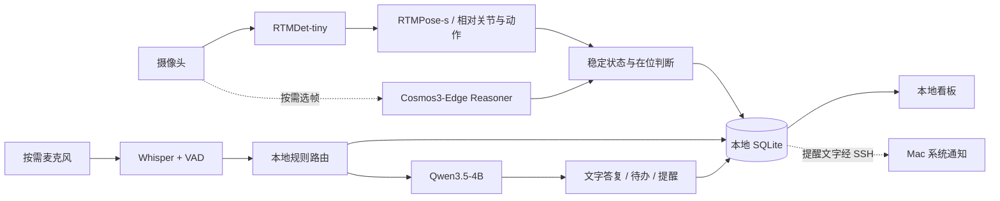

# Deskside Orin · 桌间

运行在 NVIDIA Jetson AGX Orin 上的本地工位助手。摄像头感知、模型推理和活动数据存储均在 Orin，通过中文看板查看坐站记录，使用语音或文字查询记录、添加待办与提醒。Mac 可通过 SSH/Tailscale 查看界面并接收无声系统通知。

**当前可运行，真实场景准确率仍待验收。** 椅背遮挡会影响坐站与在位识别，不能将模型统计视为人工验证的准确记录。

## 功能

- 坐姿、站姿、在位、离开、未知与隐私时段记录；人工标注另存，保留原始模型标签。
- 历史日期、全天时间轴、完整小时活动构成、重复摘要合并、站立目标。
- GPU/CPU、内存、Swap、温度、功耗、风扇、磁盘饼图与服务状态，每 15 秒更新。
- 按需实时画面，每秒 1 帧，叠加同一帧的状态、检测框和真实 RTMPose 关键点，不补画缺失关节。
- 可点击模型工作流；Whisper small/base/Turbo 本地切换，显示实际权重大小与明确标注的内存估算。
- 中文语音输入、文字答复、待办、久坐和定时提醒；Mac 无声系统通知独立于网页工作。
- 白天持续黑屏进入隐私保护，暂停预览和视觉处理；不持续录像。
- tmux 服务管理、cron 启动/监督及 SQLite 持久化。

当前产品没有扬声器输出或夜间入侵告警。

## 工作流



## 模型与环境

| 部件 | 实现 |
|---|---|
| 人体检测 | RTMDet-tiny / TensorRT FP16 |
| 姿态估计 | RTMPose-s / TensorRT FP16 |
| 视觉复核 | Cosmos3-Edge Reasoner / Transformers CUDA；保留 vLLM 实验工具 |
| 问答 | Qwen3.5-4B Q4_K_M / llama.cpp |
| 语音 | whisper.cpp + Silero VAD；基线 small，可选 base/Turbo Q5 |
| 服务与存储 | FastAPI、SQLite、tmux |

已验证设备为 Jetson AGX Orin 64GB、L4T R36.4.4、CUDA 12.6、TensorRT 10.3。模型权重、TensorRT 引擎、依赖环境不在仓库中。平铺源码目录保持与既有部署脚本的路径一致。

## 运行

首次依赖准备、模型下载/校验、引擎编译与完整运行步骤见 [重建与运行](docs/重建与运行.md)。脚本中的 `orin` 是自行配置的 SSH 别名，默认设备工作目录为 `~/Documents/orin-desk-agent`。

在依赖和模型已就绪的 Orin 项目目录：

```bash
bash stack.sh start
bash stack.sh status
```

看板监听 `http://127.0.0.1:8765`；Qwen/Cosmos 分别监听本机 `8081` / `8082`。

在 Mac 建立看板转发：

```bash
ssh -N -L 127.0.0.1:8765:127.0.0.1:8765 orin
```

然后打开 `http://127.0.0.1:8765`。语音按钮使用 Orin 的麦克风。Mac 通知接收器通过 `bash mac/install-reminders.sh` 安装，首次需允许 macOS 通知权限。

更新现有部署先备份数据库和配置。不要用源码覆盖 `data.sqlite3`、`calibration.json`、`model-selection.json`；程序回滚也不应回滚已有活动数据库。

## 测试与已知限制

无需 GPU 的回归检查：

```bash
python3 -m unittest discover -s tests -p 'test_*.py' -v
node dashboard-smoke.js < dashboard.html
```

模型预检、隔离 HTTP/断网检查、合成语音、长时间运行与真人验收见 [实施记录](docs/实施记录.md)。`experiments/` 保留特定诊断脚本和路径假设，不是通用测试入口。

历史上已完成 24 小时技术采样及多项隐私、数据保留、看板和回放检查。尚未通过的项目包括：

- 椅背遮挡下连续坐站与在位准确率，真实离开仍可能记为未知。
- 空场多帧确认至少跨 6 秒，不满足原有效切换 P95 ≤3 秒目标。
- 实体中文语音正式验收；最近一轮 6/10，仍需改善。
- 修订启动脚本后的第二次整机重启现场复验。

内存区间是规划估算。合成输入和少量照片回放不能替代真人准确率。人工确认存入 `activity_annotations`，统计读取时应用，原始模型标签不覆写。

## 目录与文档

- 根目录：当前部署代码、依赖锁定、模型校验及运行/验证脚本。
- `mac/`：原生无声通知程序、SSH 接收器和安装脚本。
- `tests/`：数据、人工标注与状态机回归测试。
- `experiments/`：语音候选、遮挡、启动恢复、断网与看板诊断。
- `fixtures/`：两个合成语音文件，不是真人录音。
- [目标与验收标准](docs/GOAL.md)
- [重建与运行](docs/重建与运行.md)
- [完整实施记录](docs/实施记录.md)
- [看板改版与识别修正](docs/看板改版与识别修正-2026-11-11.md)
- [本机证据与导入范围](docs/EVIDENCE.md)

个人摄像头照片、录音、活动数据库、逐条运行日志、模型权重、凭据及已取消功能的旧实现保留在本机，不入库。
